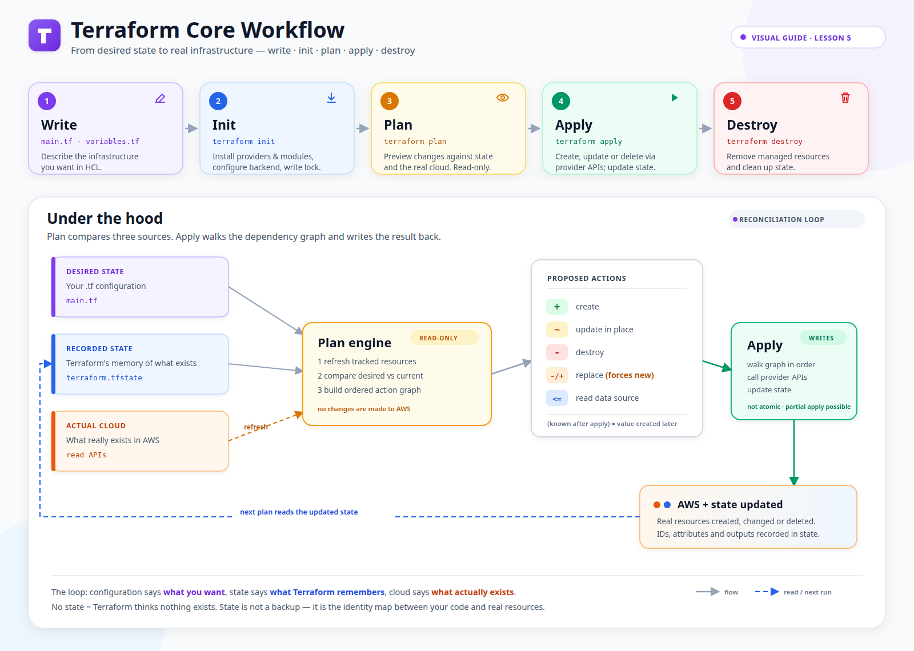

# Visual Workflow Guide

A diagram-first companion to the **Terraform Deep Dive Course**. Read this once to understand the big picture, then revisit the relevant section before each module.



*The top row is the workflow you type. The bottom panel is what Terraform does internally. Editable source: [terraform-workflow.svg](./terraform-workflow.svg).*

---

## Table of Contents

- [The One Idea](#the-one-idea)
- [Guided Tour of the Diagram](#guided-tour-of-the-diagram)
- [Plan Symbols](#plan-symbols)
- [How the Workflow Grows Through the Course](#how-the-workflow-grows-through-the-course)
- [Module 1: Foundations](#module-1-foundations)
- [Module 2: Core Concepts](#module-2-core-concepts)
- [Module 3: Intermediate](#module-3-intermediate)
- [Module 4: AWS Deep Dive](#module-4-aws-deep-dive)
- [Module 5: Advanced](#module-5-advanced)
- [The Whole Course on One Page](#the-whole-course-on-one-page)
- [How to Study With This Diagram](#how-to-study-with-this-diagram)
- [Quick Reference](#quick-reference)

---

## The One Idea

Terraform is a **reconciliation loop**, not a one-way script.

It constantly answers one question:

> “What is the difference between what I want, what I remember, and what actually exists?”

| Source | What it means | Where it lives |
|---|---|---|
| **Desired state** | The infrastructure you want | Your `.tf` files |
| **Recorded state** | What Terraform thinks it already created | `terraform.tfstate` |
| **Actual state** | What really exists in AWS | AWS APIs |

```text
Desired (.tf)  +  Recorded (state)  +  Actual (cloud)
                         │
                         ▼
                    PLAN: diff
                         │
                         ▼
                 APPLY: API calls
                         │
                         ▼
              Updated cloud + updated state
                         │
                         └──────────────► next plan
```

Everything in this course is an expansion of those three boxes.

---

## Guided Tour of the Diagram

### Top row: the five stages

| Stage | Command | Question it answers | Changes AWS? |
|---|---|---|---|
| **1. Write** | *(your editor)* | What infrastructure do I want? | No |
| **2. Init** | `terraform init` | Do I have the providers, modules, and backend? | No |
| **3. Plan** | `terraform plan` | What would change if I applied this? | No |
| **4. Apply** | `terraform apply` | Make the plan real and record the result. | Yes |
| **5. Destroy** | `terraform destroy` | Remove everything Terraform manages here. | Yes |

HashiCorp often summarizes this as **Write → Plan → Apply**. `init` is preparation, and `destroy` is cleanup. The course shows all five because beginners need the full lifecycle.

### Bottom panel: the engine room

Follow the arrows:

1. **Desired state** comes from `main.tf`, `variables.tf`, and other configuration files.
2. **Recorded state** comes from `terraform.tfstate`. It maps a Terraform address such as `aws_instance.web` to a real ID such as `i-0abc123`.
3. **Actual cloud** is read through AWS APIs during the plan’s refresh step.
4. The **Plan engine** compares all three and produces a list of proposed actions.
5. **Apply** walks the dependency graph, calls provider APIs, and updates state.
6. The **blue dashed loop** shows that the updated state becomes the input to the next plan.

> **Important:** Terraform does not scan your whole AWS account. It only refreshes resources it already knows about from state. Resources created manually in the console are invisible until you import them.

### The dependency graph

The apply box says “walk graph in order.” That graph is built from references:

```hcl
resource "aws_instance" "web" {
  ami           = data.aws_ami.amazon_linux.id
  subnet_id     = aws_subnet.public.id
  vpc_security_group_ids = [aws_security_group.web.id]
}
```

```text
data.aws_ami.amazon_linux ──┐
aws_subnet.public ──────────┼──► aws_instance.web
aws_security_group.web ─────┘
```

- An arrow means “is needed by.”
- Independent branches can be created in parallel.
- `destroy` walks the graph in reverse.
- `terraform graph | dot -Tpng > graph.png` renders the real graph if Graphviz is installed.

---

## Plan Symbols

When you run `terraform plan`, read the symbols like a diff:

| Symbol | Meaning | Typical cause |
|---|---|---|
| `+` | Create | Resource is not in state |
| `-` | Destroy | Resource is being removed from configuration |
| `~` | Update in place | A mutable attribute changed, such as tags |
| `-/+` | Replace | An immutable attribute changed, such as an AMI or bucket name |
| `<=` | Read data source | Terraform is looking up existing information |
| `(known after apply)` | Value does not exist yet | A new resource ID or ARN |
| `# forces replacement` | Change cannot be done in place | Terraform must destroy and recreate |

A replacement is the most dangerous line in a plan. Always read the reason before typing `yes`.

---

## How the Workflow Grows Through the Course

The commands never change. What changes is **how much Terraform knows and how large the graph becomes**.

| Module | What it adds | What changes in the diagram |
|---|---|---|
| **1. Foundations** | The loop itself | All five stages, one resource at a time |
| **2. Core Concepts** | State, variables, data sources, providers, meta-arguments | The three inputs become accurate and reusable |
| **3. Intermediate** | Modules, workspaces, functions, CLI, remote backends | The graph becomes reusable; state becomes shared |
| **4. AWS Deep Dive** | VPC, EC2, S3, RDS, ALB, Auto Scaling | The graph becomes a real AWS architecture |
| **5. Advanced** | Testing, CI/CD, secrets, multi-environment design | The loop becomes an automated, governed pipeline |

```text
Module 1   Write → Init → Plan → Apply → Destroy       one resource
Module 2   + state + variables + data sources          accurate loop
Module 3   + modules + remote state + graph            scalable loop
Module 4   + VPC + EC2 + S3 + RDS + ALB/ASG            real architecture
Module 5   + tests + CI/CD + secrets + environments    professional loop
```

---

## Module 1: Foundations

**Learn the loop.** **Workflow focus:** all five stages.

This module gives you the vocabulary and the first complete run of the loop.

| Lesson | Connection to the diagram |
|---|---|
| [Introduction to IaC](../01-foundations/01-intro-to-iac/README.md) | Why we describe **desired state** instead of writing imperative scripts |
| [Introduction to Terraform](../01-foundations/02-intro-to-terraform/README.md) | The engine, providers, resources, and state |
| [Setting Up Your Environment](../01-foundations/03-setting-up-your-environment/README.md) | Credentials and tools needed before **init** and **apply** |
| [Terraform Basics](../01-foundations/04-terraform-basics/README.md) | How to **write** HCL and reference data sources |
| [Core Workflow](../01-foundations/05-core-workflow/README.md) | The full **init → plan → apply → destroy** cycle |

**What to visualize:** one resource moving through all five boxes.

**After this module, you should be able to answer:**

- Which command downloads providers? → `terraform init`
- Which command previews changes? → `terraform plan`
- Which command talks to AWS and updates state? → `terraform apply`
- Where is the real resource ID stored? → `terraform.tfstate`

---

## Module 2: Core Concepts

**Make the loop accurate.** **Workflow focus:** the three inputs to the plan.

Module 1 teaches the steps. Module 2 teaches Terraform what it needs to make the steps *correct*.

| Concept | Role in the diagram |
|---|---|
| [State](../02-core-concepts/01-terraform-state/README.md) | The “recorded state” box and the memory of real IDs |
| [Variables and Outputs](../02-core-concepts/02-variables-and-outputs/README.md) | Parameterizes the **desired state**; outputs expose results |
| [Data Sources](../02-core-concepts/03-data-sources-deep-dive/README.md) | Read the **actual cloud** during plan |
| [Providers and Versions](../02-core-concepts/04-providers-and-versions/README.md) | The plugins that translate Terraform into AWS API calls |
| [Meta-Arguments](../02-core-concepts/05-meta-arguments/README.md) | `count`, `for_each`, `depends_on`, and `lifecycle` shape the graph |

```text
        variables ──► desired state
                           │
state ◄── memory ──────────┼──────────► plan
                           │
data sources ──► actual cloud
```

**What changes in the diagram:** the state box becomes central, data sources start feeding real values into the plan, and meta-arguments change the shape and order of the graph.

**Key habit:** after every apply, ask “what did state record?” Use `terraform state list` and `terraform state show`.

---

## Module 3: Intermediate

**Scale the loop.** **Workflow focus:** reusable graphs and shared memory.

| Concept | Role in the diagram |
|---|---|
| [Modules](../03-intermediate/01-modules/README.md) | Package part of the graph into a reusable unit |
| [Workspaces](../03-intermediate/02-workspaces/README.md) | Multiple state files from one configuration |
| [Functions and Expressions](../03-intermediate/03-functions-and-expressions/README.md) | Compute values before and during plan |
| [CLI Deep Dive](../03-intermediate/04-terraform-cli-deep-dive/README.md) | Inspect the graph, import resources, repair state |
| [Remote State and Backends](../03-intermediate/05-remote-state-and-backends/README.md) | Move the state box from your laptop to S3 with DynamoDB locking |

```text
                 ┌────────────────────────────┐
                 │  Remote backend (S3)       │
                 │  terraform.tfstate         │
                 │  + DynamoDB lock           │
                 └─────────────┬──────────────┘
                               │
   modules ──► reusable graph ─┼──► plan / apply
                               │
   workspaces ──► separate state┘
```

**What changes in the diagram:** the graph becomes modular, the state box becomes remote and locked, and `terraform graph` becomes useful for understanding a large configuration.

**Key habit:** treat state as shared production data. Lock it, encrypt it, version it, and never commit it.

---

## Module 4: AWS Deep Dive

**Run the loop on real infrastructure.** **Workflow focus:** graph size, dependency order, and safe cleanup.

| Lesson | What it adds to the graph |
|---|---|
| [Networking with VPC](../04-aws-deep-dive/01-networking-vpc/README.md) | VPC → subnets → route tables → IGW/NAT → security groups |
| [Compute with EC2](../04-aws-deep-dive/02-compute-ec2/README.md) | AMI data source → instance → key pair/user data |
| [Storage with S3](../04-aws-deep-dive/03-storage-s3/README.md) | Buckets, policies, versioning, encryption |
| [Databases with RDS](../04-aws-deep-dive/04-databases-rds/README.md) | Subnet groups, parameter groups, security groups, database instances |
| [Load Balancing and Auto Scaling](../04-aws-deep-dive/05-load-balancing-autoscaling/README.md) | ALB → target groups → listeners → Auto Scaling Group |

```text
provider.aws
   │
   ├──► aws_vpc.main ──► aws_subnet.public ──► aws_security_group.web ──┐
   │                                                                    ▼
   └──► data.aws_ami.amazon_linux ──────────────────────────────► aws_instance.web
                                                                        │
                                                                        ▼
                                                                   aws_eip.web
```

**What changes in the diagram:** the graph becomes large. Terraform creates independent branches in parallel, but always respects dependencies. Destroy runs in reverse order: instance before security group, security group before VPC.

**Key habit:** after `terraform plan`, trace the proposed resources from the bottom of the graph upward. Ask “what must exist before this can be created?”

**Cost reminder:** always run `terraform destroy` after exercises. The diagram’s final box is not optional in a learning account.

---

## Module 5: Advanced

**Automate and govern the loop.** **Workflow focus:** the loop as a team process.

| Concept | Role in the diagram |
|---|---|
| [Best Practices](../05-advanced/01-best-practices/README.md) | Keeps desired state clean, consistent, and reviewable |
| [Testing and Validation](../05-advanced/02-testing-validation/README.md) | Checks the configuration and plan before apply |
| [CI/CD](../05-advanced/03-cicd-with-terraform/README.md) | Automates plan, approval, and apply |
| [Secrets Management](../05-advanced/04-secrets-management/README.md) | Protects state, plans, and provider credentials |
| [Multi-Environment Architecture](../05-advanced/05-multi-env-architecture/README.md) | Runs the same loop with separate state per environment |

```text
Pull request
     │
     ▼
terraform fmt / validate / plan
     │
     ▼
Human approval
     │
     ▼
terraform apply  ──►  AWS + remote state
     │
     ▼
Destroy / next environment
```

**What changes in the diagram:** the five boxes become a pipeline. A machine runs `init` and `plan`, a reviewer approves the saved plan, and a controlled job runs `apply`. Each environment has its own state, so dev, staging, and prod are separate loops.

**Key habit:** review the plan, not just the code. The plan is the real change proposal.

---

## The Whole Course on One Page

```text
┌──────────────────────────────────────────────────────────────────────┐
│ Module 1  FOUNDATIONS                                                │
│ Write → Init → Plan → Apply → Destroy                                │
│ Goal: run the loop once and understand every box.                    │
└───────────────────────────────┬──────────────────────────────────────┘
                                ▼
┌──────────────────────────────────────────────────────────────────────┐
│ Module 2  CORE CONCEPTS                                              │
│ State + variables + outputs + data sources + providers + meta-args   │
│ Goal: make the plan accurate and the configuration reusable.         │
└───────────────────────────────┬──────────────────────────────────────┘
                                ▼
┌──────────────────────────────────────────────────────────────────────┐
│ Module 3  INTERMEDIATE                                               │
│ Modules + workspaces + functions + CLI + remote state/backends       │
│ Goal: scale the loop and share it safely with a team.                │
└───────────────────────────────┬──────────────────────────────────────┘
                                ▼
┌──────────────────────────────────────────────────────────────────────┐
│ Module 4  AWS DEEP DIVE                                              │
│ VPC + EC2 + S3 + RDS + ALB + Auto Scaling                            │
│ Goal: apply the loop to a real, dependency-heavy architecture.       │
└───────────────────────────────┬──────────────────────────────────────┘
                                ▼
┌──────────────────────────────────────────────────────────────────────┐
│ Module 5  ADVANCED                                                   │
│ Tests + CI/CD + secrets + multi-environment architecture             │
│ Goal: automate and govern the loop in production.                    │
└──────────────────────────────────────────────────────────────────────┘
```

Same engine. Same five stages. A bigger graph and more guardrails at every level.

---

## How to Study With This Diagram

Before each module:

1. Find the box or arrow the module is about.
2. Predict how the diagram will change.
3. Write down one question you want answered.

During the module:

1. Narrate what each command is doing using the diagram.
2. After `plan`, point to the proposed actions box.
3. After `apply`, point to “AWS + state updated.”
4. After `destroy`, confirm the state is empty.

After the module:

1. Close the notes.
2. Redraw the workflow from memory.
3. Explain the three inputs to a friend.
4. Check your drawing against the diagram.

### Self-check questions

1. What are the three inputs to the plan engine?
2. Which command installs providers but does not create resources?
3. Which command calls AWS write APIs and updates state?
4. What does `~` mean in a plan?
5. What does `-/+` mean, and why is it risky?
6. Why can two resources be created at the same time?
7. What happens if state is lost?
8. Why can’t `terraform plan` see a resource created manually in the console?
9. Why should state be remote for a team?
10. Which direction does `destroy` walk the graph?

---

## Quick Reference

| Command | Reads | Changes | Calls AWS? |
|---|---|---|---|
| `terraform fmt` | `.tf` files | Formats files | No |
| `terraform validate` | Configuration | Nothing | No |
| `terraform init` | Configuration, lock file | `.terraform/`, lock file | Downloads only |
| `terraform plan` | Configuration, state, AWS | Optional plan file | Read APIs |
| `terraform apply` | Configuration, state, plan | AWS + state | Write APIs |
| `terraform destroy` | Configuration, state | AWS + state | Delete APIs |
| `terraform graph` | Configuration | Nothing | No |
| `terraform state list` | State | Nothing | No |

**Commands that change infrastructure:** `apply` and `destroy`.
**Commands that only read:** `plan`, `validate`, `graph`, `state list`.
**Commands that prepare the workspace:** `init`, `fmt`.

For the full command list, see the [Terraform Cheatsheet](./cheatsheet.md). For the complete workflow lesson, see [Lesson 5: Core Workflow](../01-foundations/05-core-workflow/README.md).

---

**Start the course:** [Module 1: Foundations](../01-foundations/README.md)
